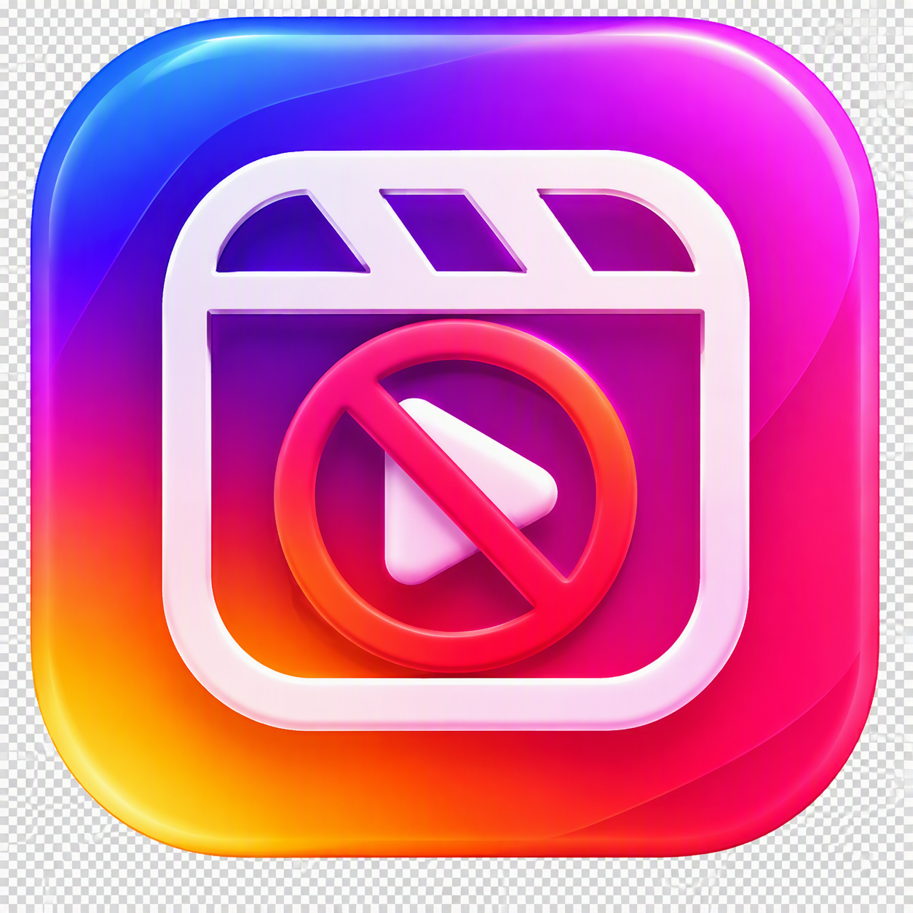

<p align="center">
  
</p>

<h1 align="center">Reels Blocker</h1>

<p align="center">
  A lightweight Android utility designed to add intentional friction to short-form video consumption.
</p>

<p align="center">
  Instagram Reels • YouTube Shorts • Facebook Reels
</p>

---

## Overview

Reels Blocker is an Android application that uses an Accessibility Service to restrict access to dedicated short-form video feeds while preserving access to other parts of supported social applications.

The objective is simple: reduce habitual entry into endless short-video feeds without blocking the entire application.

## Supported Platforms

| Application | Protected Area |
|---|---|
| Instagram | Reels |
| YouTube | Shorts |
| Facebook | Reels |

## Key Features

### Short-Video Feed Protection

Reels Blocker monitors supported Accessibility events and responds when dedicated Reels or Shorts navigation controls are activated.

The application currently supports:

- Instagram Reels
- YouTube Shorts
- Facebook Reels

### Shared and Direct Content

The application is designed to preserve access to useful shared content where possible, including supported videos opened through:

- Direct links
- Messages and DMs
- Notifications
- External applications

This allows users to reduce habitual short-form browsing without unnecessarily blocking content specifically shared with them.

### Temporary Access

Reels Blocker includes a deliberate temporary-access mechanism for situations where the user intentionally wants to access a short-video feed.

Temporary access:

- Applies independently to each supported application
- Remains active for up to 10 minutes
- Resets when the corresponding application is left or minimised

### Protection Status

The application provides an in-app status screen showing whether the Accessibility Service is currently enabled.

### Battery Optimisation Guidance

Reels Blocker can detect Android battery optimisation status and provide access to the relevant Android system settings.

Battery behaviour can vary between Android versions and device manufacturers.

### Optional Launcher Icon Hiding

After configuration, the application launcher icon can optionally be hidden while the Accessibility Service continues operating.

---

## Requirements

- Android 8.0 or later
- Android API level 26+
- Accessibility Service permission

The project currently compiles against Android API 35.

---

## Installation

### Install from a Release

Open the repository's **Releases** section and download the latest APK:

```text
Reels-Blocker-vX.X.apk
```

Install the APK on the Android device.

Android may request permission to install applications from the browser, file manager, or other application used to open the APK.

### Initial Configuration

After installation:

1. Open **Reels Blocker**
2. Select **Turn On Protection**
3. Open Android Accessibility settings
4. Select **Reels Blocker**
5. Enable the Accessibility Service
6. Return to the application
7. Review the displayed protection status

When configured successfully, Reels Blocker displays:

```text
PROTECTION ACTIVE
```

---

## Build from Source

Clone the repository and open the project using Android Studio.

The application can also be built from the command line:

```bash
gradle assembleDebug
```

The generated debug APK is located at:

```text
app/build/outputs/apk/debug/app-debug.apk
```

GitHub Actions can also be used to build the project.

---

## How It Works

Reels Blocker uses Android's `AccessibilityService` APIs to receive relevant user-interface events from supported applications.

When the service identifies a supported Reels or Shorts navigation action, it can request Android's global Back action.

Reels Blocker does not modify Instagram, YouTube, or Facebook and does not inject code into those applications.

---

## Privacy

Reels Blocker is designed to perform its blocking logic locally on the device.

The Accessibility Service is used to inspect relevant user-interface events required for the blocking functionality.

Users should review the source code before enabling Accessibility access and should only grant Accessibility permission if comfortable with the application's operation.

---

## Technical Limitations

Reels Blocker depends on user-interface information exposed through Android Accessibility APIs.

As a result:

- Accessibility labels and interface structures can change when Instagram, YouTube, or Facebook are updated.
- Behaviour can vary between Android versions and device manufacturers.
- Some application updates may require corresponding updates to detection logic.
- Android Accessibility Services cannot directly cancel another application's touch event. Reels Blocker responds after receiving supported Accessibility events.
- Direct-link and shared-content behaviour depends on how the destination application exposes the resulting screen through Android Accessibility.

---

## Releases

Compiled builds are distributed through GitHub Releases.

A published release may include:

```text
Reels-Blocker-vX.X.apk
Source code (zip)
Source code (tar.gz)
```

For normal Android installation, download the `.apk` asset.

---

## Development Status

Reels Blocker is under active development.

Detection behaviour should be retested whenever supported social applications make significant interface changes.

Bug reports and reproducible compatibility issues are welcome through the repository's issue tracker.

---

## Disclaimer

Reels Blocker is an independent project and is not affiliated with, endorsed by, or sponsored by Instagram, Meta, Facebook, Google, or YouTube.

Instagram, Facebook, Meta, YouTube, Google, Android, and other referenced names and trademarks belong to their respective owners.

---

<p align="center">
  <strong>Reels Blocker</strong><br>
  Reduce distraction. Keep control.
</p>
